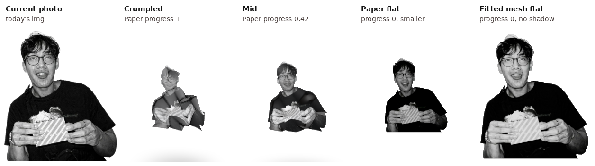

# About photo uncrumple

Checkpoint for review. No product behavior is in this branch. The spike at `/?spike=uncrumple` is throwaway.

## Problem

Danny's photo in About should start crumpled and uncrumple as the section scrolls in, then re-crumple on the way back. The scroll range is the fade that already exists in `src/components/About.jsx`: `start: 'top 96%'`, `end: 'top 18%'`, `scrub: true`. Scroll position drives the crumple directly. That drive is the ScrollTrigger's linear progress, not the `sine.inOut` on the wrapper's opacity.

At full progress the photo has to be today's photo: the same pixels, the same size, no shadow, no leftover crease. `prefers-reduced-motion: reduce` shows that photo and nothing else. Mobile uses the same slot the container query already restacks.

Paperlab 0.9.1 is installed and re-exported from `src/lib/paper.js`. Nothing calls it yet. Progress on the `crumple` behavior is inverted from the scroll: **0 is a flat sheet, 1 is crushed.** `play()` tweens toward crushed and yoyos, so it is the wrong direction. There is no scroll hook. The handles are `behavior.progress` on the props, or `PaperHandle.set('progress', value)`.

`<Paper>` owns a canvas with a fixed camera at `[0, 0.35, 2.4]`, fov 40, and `PaperLighting` with the contact shadow on. `<PaperMesh>` is the same sheet without a canvas or a lighting rig.

Frame stays a 2D ink border. It publishes `--ink-inset` and `--ink-inner`. The photo's `translateY` of about 1–2px is CSS. PR #1 left Frame out of WebGL on purpose.

## Spike

`npm run dev`, then `/?spike=uncrumple`. Cells are 240×280 on the running site. `me.webp` is 570×657 with alpha. Screenshots live in `docs/design/spike/`.



| Cell | Setup | What the pixels show |
|---|---|---|
| Current photo | `` | Nonwhite box 240×276. This is the end state. |
| Crumpled | `<Paper>` progress 1, ball 0.9, coarseness 0.62 | A crushed sheet facing the camera, not a closed ball. Faint contact shadow at the bottom of the cell (about 10/255 under white). |
| Mid | `<Paper>` progress 0.42, studio light | Creased. Same faint shadow. Aligned figure MAE against the img is 122/255. |
| Paper flat | `<Paper>` progress 0, key 0, studio 0, ambient 2, die cut | No crease facets. Nonwhite box 134×157. The cutout is smaller. Rows under the figure are pure white in this capture, so the shadow did not land, but the component still enables it. Same-coordinate figure MAE against the img is 148/255. |
| Fitted mesh flat | `<PaperMesh>` progress 0, orthographic camera fitted to the sheet, ambient light only, no `PaperLighting` | No crease facets, no shadow. Nonwhite box 228×265 against the img's 240×276. After scaling those boxes onto each other, figure MAE is 13/255 and 67% of figure pixels differ by more than 8. Mean tone is only about 3/255 darker. The rest is edges, the die-cut inset, and the 1024-long-edge resample. See `spike/compare-mesh.png`. |

Progress 0 is geometrically flat. The deformer returns immediately when `amount` is 0. That is not the same as the ``. Turning the shadow off and fitting the plane removes the shadow and most of the size error, and it still fails "identical" and "no size change."

## Usage (caller's view)

The scroll owner stays the tween that is already in `About.jsx`. One new callback writes the pose. The photo component does not receive progress.

```jsx
gsap.fromTo(revealRef.current, { opacity: 0 }, {
  opacity: 1,
  ease: 'sine.inOut',
  scrollTrigger: {
    trigger: aboutRef.current,
    start: 'top 96%',
    end: 'top 18%',
    scrub: true,
    onUpdate(self) {
      const pose = poseFromScroll(self.progress)
      paperRef.current?.set('progress', pose.crush)
      paintPose(slotRef.current, pose)
    },
  },
})
```

```jsx
<div className="about-photo-slot" ref={slotRef}>
  
  {motion && <AboutPhoto handleRef={paperRef} />}
</div>
```

`motion` is true only inside the existing `gsap.matchMedia()` gate for `prefers-reduced-motion: no-preference`. Reduced motion never mounts a canvas. The img keeps the CSS it has today, including `object-fit: contain` and the ink `translateY`.

Signatures, with `not implemented` bodies, are in `about-uncrumple.sketch.js`.

## Shape

One number in, one pose out. `poseFromScroll` is a pure function of linear scroll progress.

```text
t = clamp(scrollProgress, 0, 1)
HANDOFF = 0.92

t = 0            crush 1, img opacity 0, canvas opacity 1
t in (0, 0.92]   crush goes 1 → 0, img stays hidden, canvas stays shown
t in (0.92, 1)   crush stays 0, img fades 0 → 1, canvas fades 1 → 0
t = 1            img opacity 1, canvas not displayed
```

`paintPose` writes those opacities on the slot's img and canvas. It does not go through React. At `t = 1` it also sets the canvas to `visibility: hidden`, so a transparent WebGL buffer cannot sit on top of the photo or leave a shadow. Scrolling back runs the same function, so the crossfade reverses and then the sheet re-crumples.

The canvas is a child of `.about-photo-slot`, absolutely positioned with the same `inset` and the same `translateY` as `.about-photo`. One CSS rule, both elements. The 1–2px drop onto the ink is not remeasured in JavaScript. `AboutPhoto` fits an orthographic camera to a sheet of aspect 570/657, so the rest plane fills that box the way `object-fit: contain` does. While the sheet is crushing, `ball` pulls it inward. That shrink is the crumple. It is not the finished size.

`AboutPhoto` renders `<PaperMesh>` from `src/lib/paper.js`. Stock `photo-gloss` (no default grain). `surface.dieCut` with margin 0, so the transparent ground of `me.webp` is discarded. `autoplay` false. Initial `behavior.progress` is 1, so the first WebGL frame is crumpled. The reveal wrapper is already opacity 0 on that first paint, except under reduced motion, where this component is absent. No `<Paper>`. No `PaperLighting`. One ambient light. `dpr={[1, 2]}`, matching Frame's cap.

The public surface of `AboutPhoto` is the handle ref. Camera fit, stock, die cut, and light stay inside it. About knows scroll and the pose. It does not know about three.

What this deliberately does not do: no second GSAP tween, no page-level canvas, no edit to Frame, no new package, no attempt to make MeshStandardMaterial match the img.

## Synthesis decision

Two whole shapes were framed. Claude Opus and Claude Sonnet could not take a seat (weekly usage), so there was no cross-family judge. The two runners had not written files when this checkpoint was closed. The shapes below are the ones that were framed, scored against the spike.

**Base: the slot-sized canvas, plus the img as the finished photo.** The page-level canvas lost. It would keep a second copy of the slot's rectangle, including the container-query restack and the ink `translateY`, and it would not make the finished frame identical. One photo does not need a shared context.

Grafted from the "fit the plane and kill the shadow" option: the *during-crumple* renderer is the fitted `<PaperMesh>` with no lighting rig. That is what the spike showed can be crease-free and shadow-free while the sheet is moving. It is not the end state. The end state is the img, because that same spike measured MAE 13 and a smaller box after the fit.

Rejected:

- `<Paper>` as the photo. Fixed camera, smaller cutout (134×157 vs 240×276), contact shadow enabled.
- Leaving the fitted mesh up at progress 1. Geometrically flat, not the same pixels, not the same box.
- A GSAP tween whose value is paper progress. Scrub on the existing trigger is already the scroll. A second tween is a second clock.
- `usePrefersReducedMotion` or `usePaperStates`. Neither one reads scroll. Reduced motion is the matchMedia gate that already skips the fade. The hook would not hide WebGL.
- `play()`. It animates toward crushed.

## Tradeoffs accepted

- We accept a short crossfade over the last 8% of the trigger in exchange for a finished photo that is the real img. A hard swap on the last frame would pop: the best flat mesh is still MAE 13 and a few pixels smaller.
- We accept that the crumpled pose is a crushed sheet facing the camera, not a closed ball. `ball` 0.9 was the spike. Tuning seed, coarseness, and ball is data, not a new shape.
- We accept one WebGL context the size of the photo for visitors who allow motion. It unmounts with the gate. Reduced motion pays nothing.
- We accept `poseFromScroll` as a named function in `About.jsx` rather than a new module. It is the invariant. A file that only one caller imports would be a pass-through.
- We accept the die-cut's 2px inset and the 1024 texture during the crumple. They are invisible at the end because the canvas is gone.

## Alternatives considered

**Shared page canvas.** One fixed canvas, `PaperMesh` repositioned every frame from `getBoundingClientRect`. Hides the WebGL context policy. Exposes layout: the caller has to know the slot's transform, the container query, and the ink offset, which CSS already owns. Interface is wider, and the identical-end problem is unchanged. Lost.

**Fitted mesh as the finished photo.** Disable the shadow, orthographic fit, progress 0. Hides the handoff. Exposes a material that cannot match the img (spike MAE 13, box 228×265 vs 240×276). Fails the hard requirement. Kept only as the in-between renderer.

**Second GSAP tween, or a Paperlab hook, as the progress channel.** Both add a writer beside the trigger that already has `self.progress`. The hook does not have a scroll input. The `set('progress')` call from `onUpdate` is one writer.

## Open questions and risks

- Is 0.92 the right handoff, or should the img take over sooner or on a hard cut?
- The spike's progress 1 reads as a crushed sheet, not a ball in a fist. Do you want `ball` and `coarseness` pushed further before implementation?
- `ScrollTrigger` against `100svh` while the mobile URL bar shows and hides was not measured. The range stays the fade's range either way.
- StrictMode in dev unmounts `<Paper>`, and `<Paper>` calls `forceContextLoss`. The recommended component is `<PaperMesh>` inside a canvas we own, so that path should not run. Worth a look on the first implementation pass.

## Verification

Extend `e2e/motion.spec.js` from the open Playwright PR (`cursor/verify-dmaiwebsite-1f0a`), which already scrolls About to top 96%, 57%, and 18%, checks `#about-title` opacity, turns scroll-snap off, and covers reduced motion. Do not replace those checks.

Observable checks, added beside the existing samples:

- At top **18%** (full progress): `img.about-photo` has opacity 1, and the slot's canvas is missing or not visible (`visibility: hidden` or opacity 0). A screenshot of the slot matches the img within MAE 2/255. The spike's best canvas missed this: fitted mesh MAE 13 after alignment, Paper's flat pose a different box entirely. Either "the img is what you see" or "the canvas matches within 2" passes. The canvas we can actually render does not pass 2, so the implementation that shows the img is the one that passes.
- At top **57%** (the existing midpoint): the slot is not that flat photo. Figure MAE against the flat img is greater than 30. The spike's mid pose was 122, so a real crumple clears 30 and a flat img does not.
- Scroll back from 57% to **96%**: the slot differs from the 57% shot. That is the re-crumple. No assertion on a progress number or on which component ran.
- Reduced motion, at 96% and at 18%: no canvas in the slot, img opacity 1, and the same MAE ≤ 2 match. The photo does not crumple.
- Mobile, 390×844: repeat the 18% match and the 57% not-flat check. The slot stacks there (`@container about-frame (max-aspect-ratio: 1)`). The behavior is the same component, so the same bands apply.

A test that reads `PaperHandle.getProgress()` or the HANDOFF constant is pinned to the sketch. The slot screenshot is what a visitor sees.

## Next implementation step

Add `poseFromScroll` and the `onUpdate` on the existing trigger, and mount `AboutPhoto` only inside the reduced-motion gate, with the img still the node that remains at progress 1.

## Principles

- **Laziness protocol.** The smallest change that meets "identical, no shadow, no size change" is to keep the img and add one slot-sized canvas for the part of the scroll where the sheet is actually crumpled. A page canvas, a second tween, and a material fork are more code for a worse end frame.
- **Experience first.** The finished photo is what Danny's site shows today. The spike's fitted mesh is close to the eye and still the wrong picture to land on.
- **Prove it works.** The recommendation follows the screenshots and the MAE, not the schema comment that progress 0 is "flat."
- **Exhaust the design space.** Slot canvas versus page canvas, and img handoff versus a fitted shadow-free mesh. The mesh fit is used. It is not the end state.
- **Foundational thinking.** One pure pose from one scroll number. Opacity and crush are derived. They are not stored.
- **Test behavior, not implementation.** The Playwright extension looks at the slot and the img. It does not look at the handle.
- **Minimize reader load.** About.jsx remains the only place that knows the scroll range. `AboutPhoto` hides the sheet.
